<div align="center">

# 📱 App Store Screenshot Studio

### Professional App Store screenshots from your simulator captures, generated by your AI agent.

**11 design presets · 13 starter templates · 17 professional Figma kits distilled into code · No API keys**

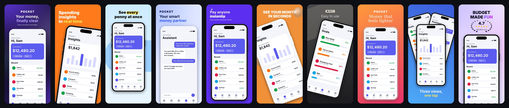

[](LICENSE)


</div>

---

Your app is ready. Now it needs screenshots, and they are the **first thing users judge** on the App Store,
before they read a single word of your description.

Most developers end up with one of three results: the raw simulator screenshots, a Canva template everybody
already uses, or a few hours of fighting Figma. **App Store Screenshot Studio** is an *Agent Skill* that handles
the job end to end. You tell your AI "make App Store screenshots for my app", and it:

1. **Reads your Swift/SwiftUI code** to find the benefits that actually sell your app.
2. **Writes the headlines**: short, verb-first and benefit-led, with the payoff on line two.
3. **Captures the screens** with `simctl` at the exact 6.9" size (status bar 9:41, full battery).
4. **Picks an art direction** from a library distilled from 17 professional Figma kits, and shows you 2-3 options.
5. **Renders pixel-exact PNGs** (1320×2868, plus 6.5" and iPad on request), or builds an **editable Figma file**.
6. **Reviews its own output** against a checklist (text overlap, sizes, glyphs, misleading claims) before handing it over.

Every set comes out different. The skill deliberately varies family, alignment, caption position and device
treatment between apps, so your listing does not look like everyone else's.

## ✨ Gallery

All images below were rendered by `scripts/compose.py` from the bundled demo screens. They are not Figma mockups.

| Bold flat | Glass AI |
|---|---|
| 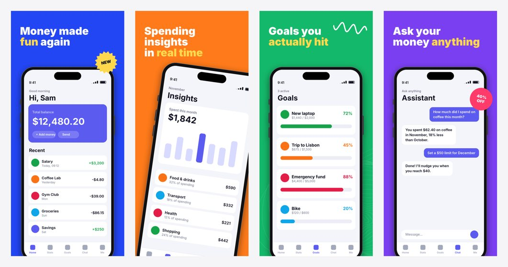 | 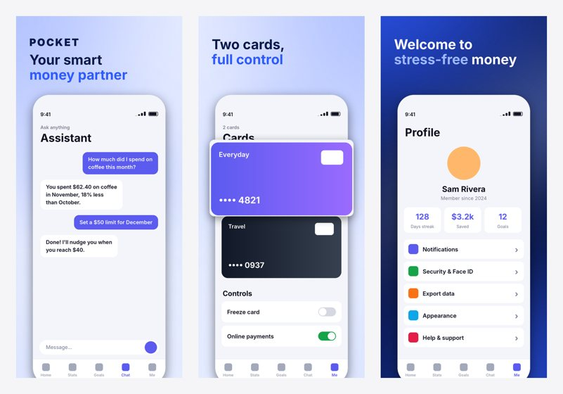 |
| **Marker** | **Fintech** |
| 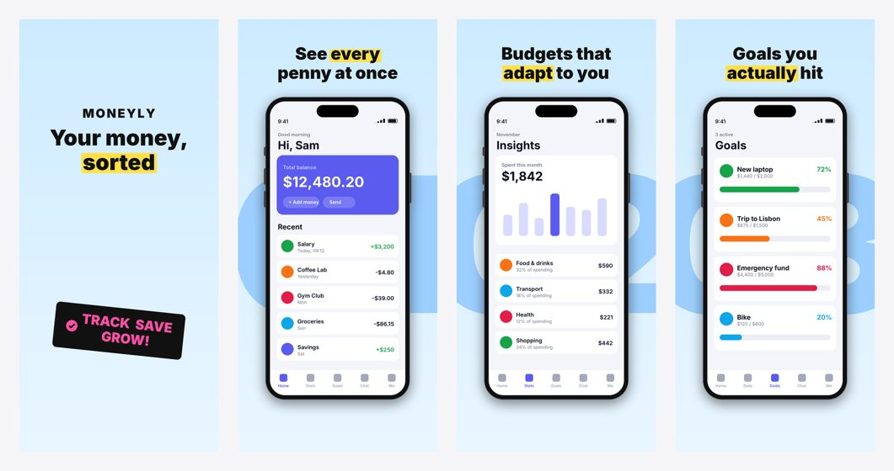 | 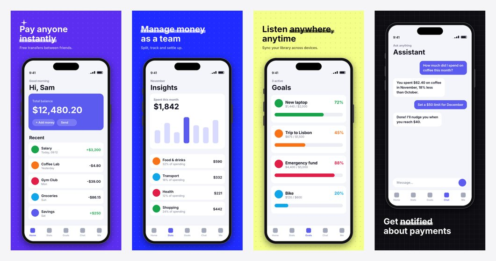 |
| **Mono editorial + panorama** | **Panorama split** |
| 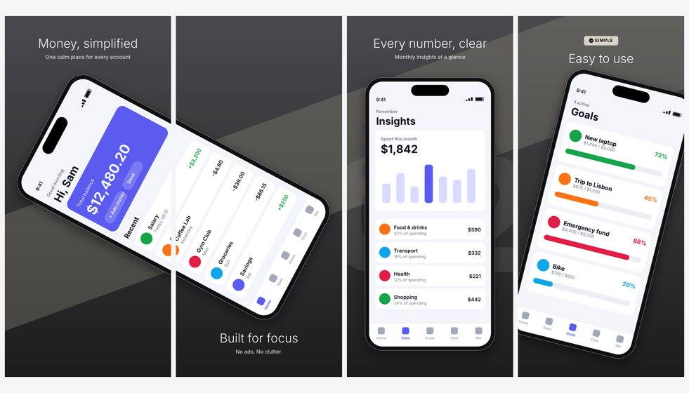 | 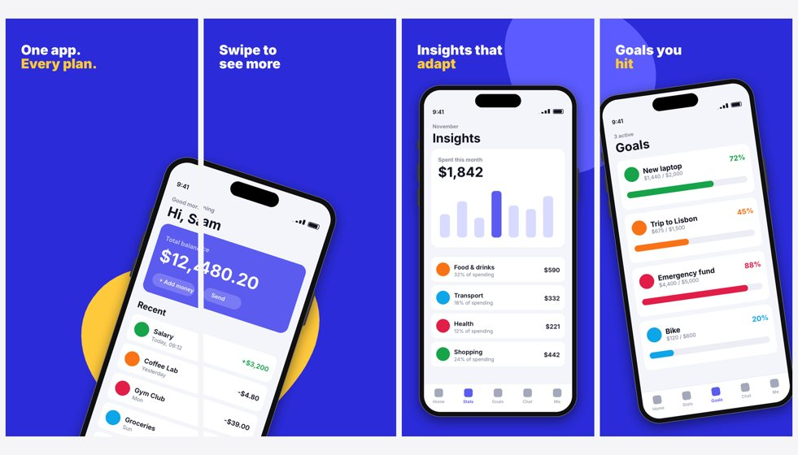 |
| **Aurora** | **Caption bottom + phone fan** |
| 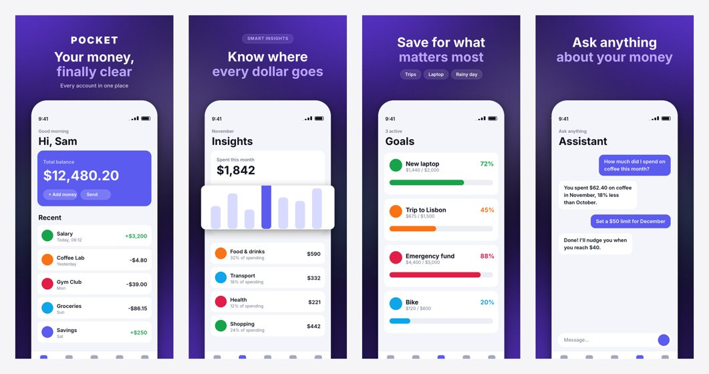 | 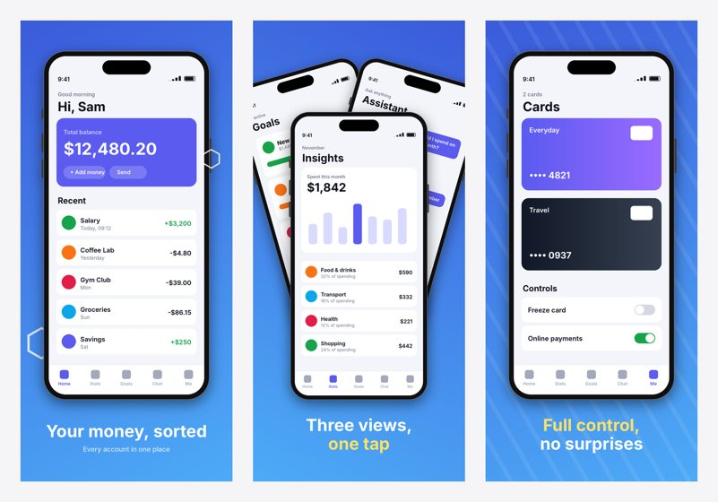 |
| **Soft 3D** | **Sunset (editorial serif)** |
| 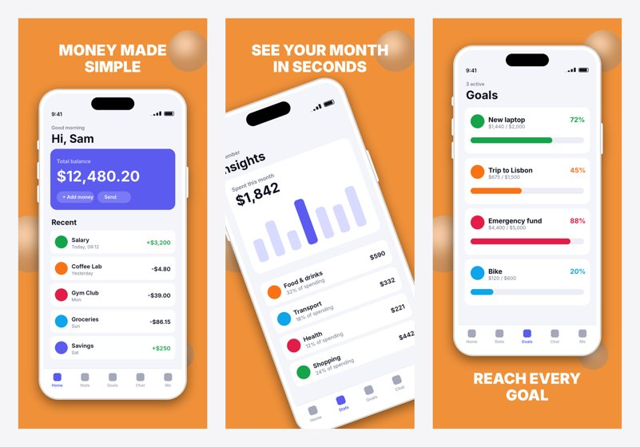 | 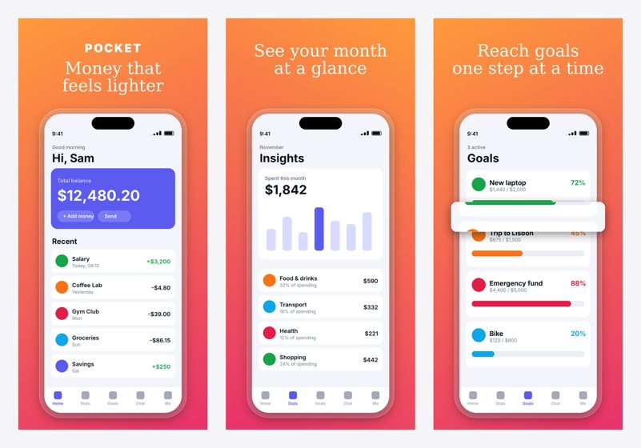 |
| **Light pop** | **Duotone** |
| 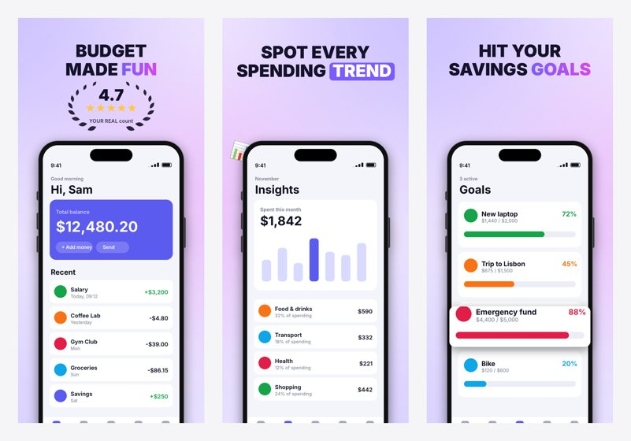 | 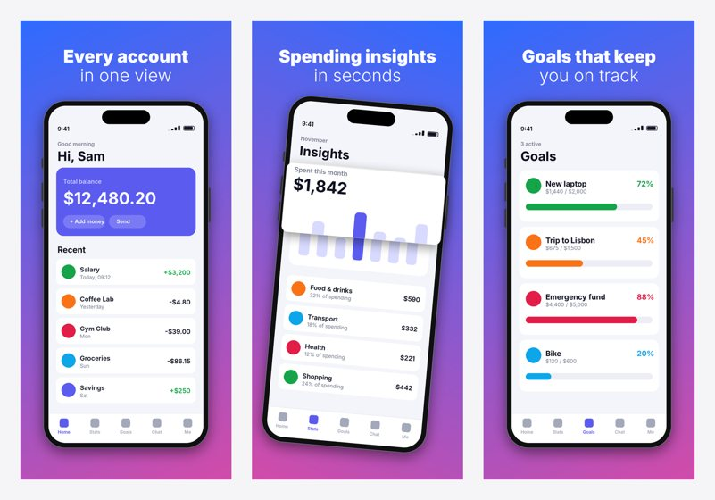 |

## 🧰 What's inside

| | |
|---|---|
| **11 presets** | `classic` `aurora` `sunset` `duotone` `light-pop` `bold-flat` `marker` `mono` `soft-3d` `fintech` `glass-ai` |
| **Layouts** | centred / left / right headlines · caption on top or **under the phone** · text-only hero frames · **panoramas** where phones, blobs and bands cross frame seams |
| **Devices** | realistic iPhone frame (black, **white** or **tinted** bezel) · frameless screen · glass ring · tilt · **extra phones** (fans, duos, before/after) |
| **Headlines** | two-tone (accent or light line 2) · keyword in colour, **highlighter marker**, pill, gradient or underline · Turkish-aware capitals (`İ`) |
| **Extras** | **pop-out UI cards** lifted out of the screen · giant numerals · stickers and badges (starburst, pill, check tag) · rating laurel · chips · eyebrow labels |
| **Texture & decor** | aurora / mesh / pastel / linear backgrounds · dot grid, grid, stripes, diagonal band, topographic contours, rings · glossy 3D spheres, organic blobs, hexagons, waves, sparkles, emoji, your own PNGs · film grain |
| **Output** | exact App Store sizes · `showcase.png` strip to preview the swipe · fastlane folder layout · or an editable **Figma** file via the Figma MCP |

The design knowledge lives in two plain-markdown references that your agent reads before designing:

- [`references/design-patterns.md`](references/design-patterns.md): every pattern, config key and Figma recipe.
- [`references/figma-examples.md`](references/figma-examples.md): a catalogue of **17 free Figma Community
  screenshot kits** (BRIX, ASO.dev, AppLaunchpad, Aweb, const lab and more). For each kit it lists the signature
  moves, how to reproduce them in code, and how to rebuild them in Figma, grouped into a family picker.

## 🚀 Install

### Claude Code
```bash
git clone https://github.com/ahmetutluau/ios-appstore-screenshots ~/.claude/skills/ios-appstore-screenshots
pip install -r ~/.claude/skills/ios-appstore-screenshots/requirements.txt
```
Then, inside your Xcode project: *"Make App Store screenshots for this app."*

### Claude.ai / Claude desktop
Download the repo as a ZIP and upload it in **Settings → Capabilities → Skills**.

### Other AI agents (Codex, Cursor, Gemini CLI, ...)
The skill is a standard `SKILL.md` folder. Put it wherever your agent loads skills or instructions from, or tell
the agent: *"Follow `ios-appstore-screenshots/SKILL.md`."* The renderer is a plain Python script, so it works the
same everywhere.

## ⚡ Try it in 30 seconds (no AI needed)

```bash
pip install -r requirements.txt
python3 scripts/make_demo_screens.py             # 6 demo iPhone screens -> examples/raw/
python3 scripts/compose.py examples/bold-flat.json
open examples/screenshots/final/showcase.png
python3 scripts/compose.py --themes               # list all presets
```

A config is small and readable:

```json
{
  "theme": "fintech",
  "bg": "#5B2EF0", "accent": "#FFFFFF",
  "frames": [
    {"screenshot": "raw/01.png", "headline": "Pay anyone\ninstantly", "highlight": "instantly",
     "sub": "Free transfers between friends."},
    {"screenshot": "raw/02.png", "bg": "#1F2BFF", "headline": "Manage money\nas a team",
     "text_pos": "bottom", "devices": [{"screenshot": "raw/03.png", "at": [0.7, 0.1], "tilt": -14}]}
  ]
}
```

Use `--only N` to iterate on a single frame. Every key is documented in `references/design-patterns.md`.

## 🎨 Figma mode

With the [Figma MCP](https://help.figma.com/hc/en-us/articles/32132100833559) connected, the agent builds an
editable Figma file instead: real text layers, a reusable template, one page per locale. To start from one of the
17 reference kits, open it in Figma, click **Duplicate** and give the agent the link to your copy. (The MCP can't
edit Community files directly.)

## 🛡️ Built-in honesty

App Store guideline 2.3.7 rejects misleading screenshots. The skill **never invents** ratings, user counts or
awards. Template placeholders like "4.7", "#1" or "Editors' Choice" must be replaced with real data or removed,
and the final checklist enforces it.

## 🤝 Contributing

New styles are welcome. A good PR adds:
1. a preset in `THEMES` (or new keys) in `scripts/compose.py`,
2. a starter config in `examples/`,
3. a preview in `docs/previews/` (render it from the demo screens),
4. a row in `references/figma-examples.md` or `design-patterns.md` explaining when to use it.

Ideas: Android / Google Play sizes, iPad layouts, an RTL headline mode, more device frames (Pixel, iPad Pro).

## 🙏 Credits

The style families were studied from free Figma Community kits by BRIX Templates / BRIX Agency, ASO.dev,
AppLaunchpad, Aweb, const lab, Farhan Shakir, madewithjello, Lauren Tobolski, Arzu Cetinkaya and other authors
(links in `references/figma-examples.md`). This project only links to those kits and re-implements general layout
ideas in its own code. No Figma assets are redistributed, and it is not affiliated with any of these authors or with Apple.

## 📄 License

[MIT](LICENSE). Use it, fork it, ship better screenshots.
